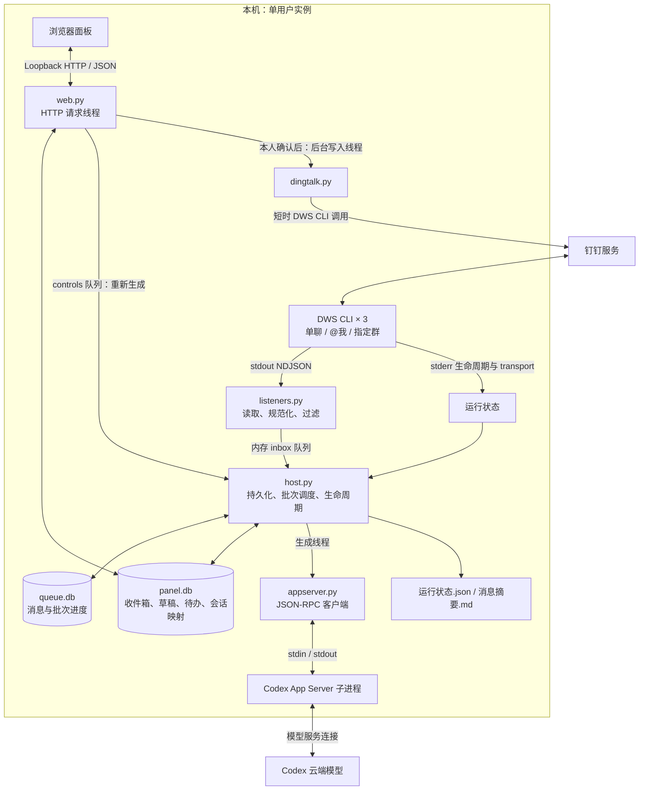
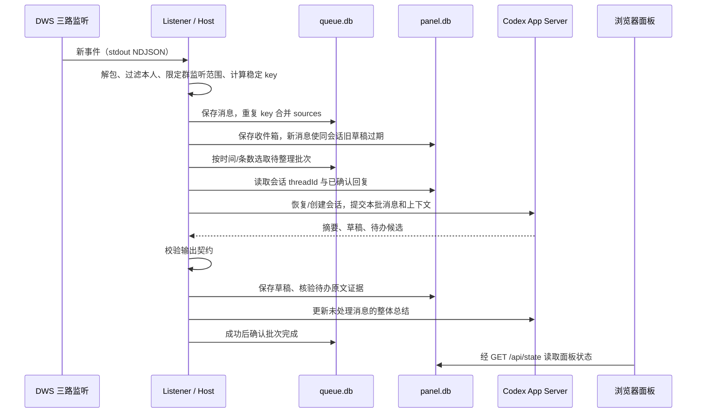
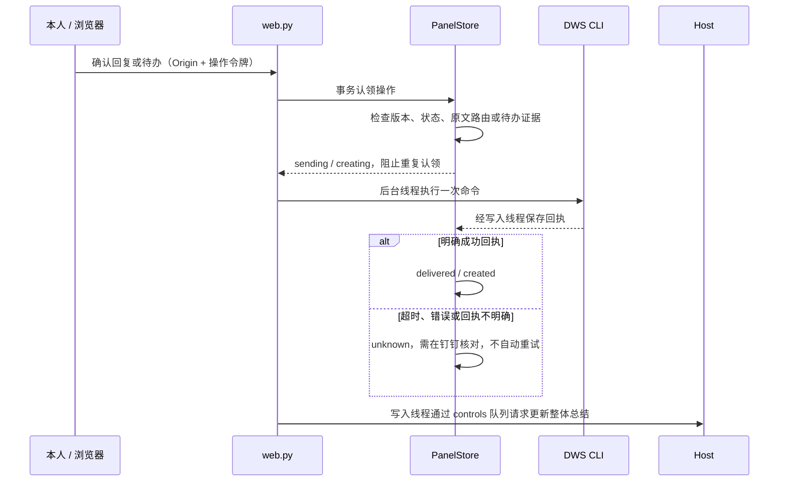

# 架构与通讯链路

项目采用 Python 标准库后端、SQLite 和原生 HTML/CSS/JavaScript。一个 Host 主进程负责监听调度、AI 整理和本地 HTTP 面板，外部能力由 DWS 与 Codex CLI 子进程提供。运行网页无需 Node 构建；CLI 的安装及启动环境仍需按安装文档配置。

## 系统架构

三个 DWS 订阅按顺序建立，避免共享事件总线初始化竞争；每路由独立线程读取 stdout 与 stderr。Host 主循环负责队列数据库，AI 生成线程串行处理会话，再通过 results 队列把批次结果交回主循环。PanelStore 每次操作独立连接，写入状态使用事务保护。

## 模块职责与维护入口

| 模块 | 职责 |
| --- | --- |
| `cli.py`、`config.py` | init/doctor/run/service/share 入口；配置校验、路径解析与状态目录身份绑定 |
| `diagnostics.py`、`distribution.py` | 依赖及登录诊断；macOS 启动项与分享白名单 |
| `listeners.py`、`events.py` | DWS 子进程、状态采集；事件解包、本人过滤、指定群边界与去重键 |
| `queue_store.py` | 接收队列、来源合并、历史回放、到期批次、确认与重新入队 |
| `host.py` | 将接收、存储、生成、面板控制及退出流程串起来 |
| `panel_store.py`、`schema.sql` | 收件箱、草稿版本、待办证据、会话映射及操作状态事务 |
| `appserver.py` | Codex stdio 协议、会话恢复、生成结果接收与工具请求拒绝 |
| `prompts.py`、`ai_contract.py` | 唯一通用提示词；AI 输出 schema 与校验 |
| `web.py`、`static/` | 本地 HTTP API；HTML、CSS、JS 面板及状态轮询 |
| `dingtalk.py` | 已确认回复与待办的外部写入、回执交回存储层 |
| `utils.py` | 时间与原子状态文件写入 |

根目录 `ears.py` 仅兼容旧启动命令。`tests/` 包含配置、协议、存储、HTTP、Host 生命周期及分发回归；`scripts/check.py` 是统一检查入口。

## 通讯边界

| 发起方 → 接收方 | 通道 / 协议 | 内容与约束 |
| --- | --- | --- |
| Host → DWS 监听进程 | `dws event +listen-im --format ndjson` | 三路 `all-direct`、`at-me`、`group --chat-id`，统一指定 profile |
| DWS → ListenerManager | stdout NDJSON；stderr 文本 | stdout 为事件；stderr 为订阅生命周期和 transport 状态，分别消费 |
| ListenerManager → Host | 进程内 `queue.Queue` | 规范化消息；Host 再写 queue.db 与 panel.db |
| Host ↔ Codex App Server | stdio，逐行 JSON-RPC | initialize、thread/start/resume/fork、turn/start 与完成通知；输出受 schema 校验 |
| 浏览器 ↔ Web | `http://127.0.0.1:<port>` | 静态资源；每 1.5 秒 GET `/api/state`；人工操作 POST `/api/*` |
| Web → Host | controls 队列 | 重新生成单条或整体总结；生成结果经 results 队列回到 Host |
| 写入线程 → DWS | subprocess，JSON 回执 | `chat +messages-send` / `todo +remind`，超时 60 秒，不自动重试 |

项目不直接实现钉钉或模型云端协议，远端连接由各 CLI 管理。HTTP 仅绑定 127.0.0.1，校验 Host、Origin 和随机操作令牌；第三方文本通过 textContent 渲染。项目没有多用户认证系统。

## 从新消息到草稿

默认单聊/@我等待 30 秒、普通群等待 300 秒；待处理窗口达到 20 条提前触发，每批最多 50 条。重复来源合并后，带 @我的消息采用较短等待时间。整体总结最多取面板快照中的 40 条未处理消息。

消息先保存再整理。AI 出错时暂停生成并保留待处理批次，用户可重新生成；整体总结单独更新失败时保留原总结并展示错误，不阻塞已生成批次的确认。`ued` 是旧数据库兼容来源键，实际群 ID、名称来自配置。

## 本人确认后的外部写入

回复目标取自存储的原消息，浏览器和模型均不能指定其他收件人。发送前检查草稿版本、消息处理状态和同会话最新消息；幂等键在调用前已持久化。待办候选必须绑定本批消息，且证据为来源文本的逐字片段；手动待办复用相同存储校验与创建入口。

AI 没有发送工具：App Server 禁用 shell、补丁、Apps 和 MCP，并拒绝工具与权限请求。`sending` / `creating` 在重启时恢复为 `unknown`，不会恢复为可重试。已投递、忽略或手动处理的消息下沉，后端阻止重复回复。

## 数据与运行状态

| 位置 | 内容 |
| --- | --- |
| `paths.state_dir` | queue.db、panel.db、identity.json、host.lock、监听日志、agent/ 会话及 App Server 日志 |
| `paths.output_dir` | 持续更新的运行状态.json、追加的消息摘要.md |
| `config.local.json` | 私有身份、关注群、端口、目录、CLI 与聚合参数；不保存 token |

状态目录绑定账号及关注群，Host 文件锁防止同一目录重复运行。无身份标记的旧数据库须备份、核对后显式认领；不同账号使用独立目录。PanelStore 构造时会恢复未完成操作，只在启动时构造，不能为读取运行状态重复实例化。

订阅 `ready` 仅表示订阅就绪，不能证明真实事件已投递；transport 的 `degraded` / 断开要单独报告。接收计数只属于本次进程，重启归零；历史数据继续保留。App Server 按会话保存 threadId，仅遇到明确的旧 writer 冲突时 fork 原历史。

## 扩展约束

- 通用提示词只改 `prompts.py`，输出契约只改 `ai_contract.py`。个人称呼、群名通过每轮 context 数据传入。
- 保持数据库结构和旧来源键兼容。不标记钉钉消息已读，不自动识别附件，不自动设定待办截止时间，不接入 OA 审批。
- 分享由 `distribution.py` 白名单控制；配置、凭据、数据库、日志、摘要和截图不分发。包资源包含 static/ 与 schema.sql。
- 外部 Hooks 只在草稿生成后由 `hooks.py` 后台投递，失败不影响整理；回调复用 `claim_send` 与归档链路，见 [外部 Hooks](外部Hooks.md)。
- 安装、登录、前后台启动及排错见 [安装配置与启动](安装配置与启动.md)。
